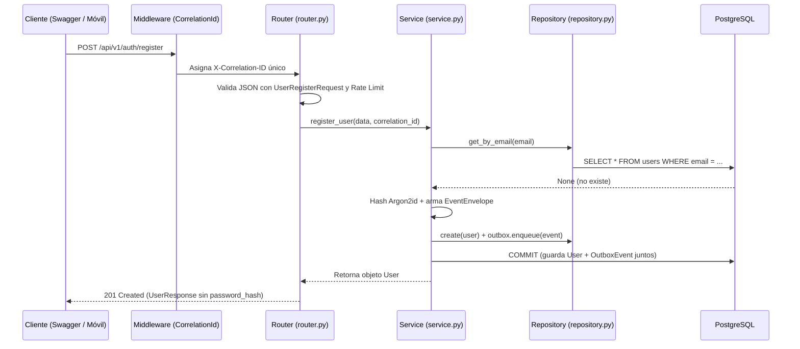
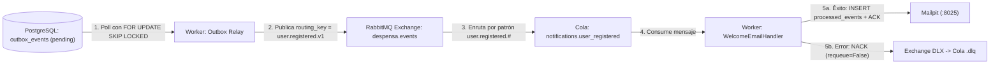

# Guía de Estudio y Práctica: Arquitectura Python y Etapa 1

> **¿Eres nuevo en Python?** Empieza primero por [fundamentos_python_y_practica.md](file:///c:/Users/buda_/Documents/AI_projects/Despnsa%20project/docs/fundamentos_python_y_practica.md), donde tienes la documentación oficial, ejemplos ejecutables y 9 ejercicios guiados de Python, `async/await`, Pydantic, SQLAlchemy, FastAPI, RabbitMQ y Pytest.

Esta guía explica **desde cero** cómo funciona Python en este proyecto y cómo se conectan todas las capas que construimos en la **Etapa 1** (`API`, `Base de Datos`, `Seguridad`, `Outbox`, `RabbitMQ`, `Worker` y `Docker`). Al final encontrarás **preguntas de verificación** y **ejercicios prácticos** para comprobar que dominas cada nivel.

---

## Nivel 1: Fundamentos de Python en este Proyecto

Si vienes de otros lenguajes (Java, C#, JS/TS, PHP), estos son los 5 pilares de Python que ves en cada archivo de `src/app/`:

### 1.1 Módulos, Paquetes e Imports
- **Módulo:** cualquier archivo `.py` (ej. `security.py`).
- **Paquete:** una carpeta con un archivo `__init__.py` (ej. `src/app/modules/users/`).
- Cuando ves `from app.core.config import Settings`, Python busca dentro de `src/` la carpeta `app/core/`, abre `config.py` e importa la clase `Settings`.

### 1.2 `type hints` (Tipado Estático)
Python es dinámico en ejecución, pero en proyectos profesionales anotamos los tipos para evitar bugs antes de correr el código:
```python
async def get_by_email(self, email: str) -> User | None:
```
- `email: str` significa que recibe un texto.
- `-> User | None` significa que devuelve un objeto `User` o `None` (vacío).
- La herramienta **`mypy`** lee estas anotaciones sin ejecutar el código y te avisa si intentas usar algo que podría ser `None` o de otro tipo.

### 1.3 `async` / `await` (Programación Asíncrona)
Imagina un mesero en un restaurante:
- **Síncrono (bloqueante):** toma una orden, va a la cocina y se queda mirando el sartén 10 minutos sin atender a nadie más.
- **Asíncrono (`async def` + `await`):** toma la orden, la pasa a cocina (`await db.execute(...)`), y mientras PostgreSQL responde, atiende a otros usuarios.
- En FastAPI, cada ruta (`router.py`), llamada a PostgreSQL (`AsyncSession`) y publicación a RabbitMQ (`aio_pika`) usa `await` para soportar muchas peticiones concurrentes con poca memoria.

### 1.4 `Pydantic` (`BaseModel` y `BaseSettings`)
Es el "guardia de aduana" de tus datos:
- En [schemas.py](file:///c:/Users/buda_/Documents/AI_projects/Despnsa%20project/src/app/modules/users/schemas.py), `UserRegisterRequest` valida automáticamente que `email` tenga formato de correo, `password` tenga entre 8 y 128 caracteres, y `timezone` sea una zona horaria real. Si algo falla, FastAPI responde **HTTP 422** solo.
- En [config.py](file:///c:/Users/buda_/Documents/AI_projects/Despnsa%20project/src/app/core/config.py), `Settings` lee variables de entorno (`.env` o `docker-compose.yml`) y falla rápido al arrancar si un tipo está mal.

### 1.5 `Protocol` (Puertos y Adaptadores)
En [ports.py](file:///c:/Users/buda_/Documents/AI_projects/Despnsa%20project/src/app/shared/ports.py) definimos contratos (`EventPublisher`, `EmailSender`) sin decir *cómo* se implementan:
- Hoy el adaptador de correo es `SMTPEmailSender` (hacia Mailpit) y el de eventos es `RabbitMQEventPublisher`.
- En la **Etapa 5**, crearemos `AWSSNSEventPublisher` con exactamente el mismo método `publish(event)` sin tener que cambiar la lógica de negocio.

---

## Nivel 2: Cómo Viaja una Petición HTTP por la API (FastAPI)

Cuando un cliente (tu futuro móvil iOS/Android, la Web o Swagger) envía `POST /api/v1/auth/register`, la petición atraviesa estas capas en orden:



### Qué hace cada archivo en `src/app/modules/users/`
1. **`router.py` (Capa HTTP):** solo conoce rutas (`/auth/register`), códigos HTTP (`201`, `204`) y esquemas Pydantic. **Nunca** escribe SQL ni lógica de negocio.
2. **`dependencies.py` (Inyección de Dependencias):** FastAPI usa `Depends(...)` para entregar automáticamente a cada ruta la sesión de BD (`AsyncSession`), el servicio (`UserService`), el *rate limiter* o el usuario autenticado (`get_current_user`).
3. **`service.py` (Cerebro del Negocio):** toma decisiones (¿el correo ya existe? ¿la contraseña coincide? ¿qué evento debo emitir?). Si algo viola una regla de negocio, lanza una `DomainError` (como `EmailAlreadyExistsError`), nunca `HTTPException` directo.
4. **`exceptions.py` (`core/`):** intercepta cualquier `DomainError` y la convierte en una respuesta estándar **RFC 7807** (`application/problem+json`) con `type`, `title`, `status`, `detail` y `correlation_id`.
5. **`repository.py` (Capa de Datos):** único lugar donde existen consultas SQLAlchemy (`select`, `update`, `session.add`).

---

## Nivel 3: Base de Datos, SQLAlchemy y Migraciones (Alembic)

### 3.1 ORM vs SQL puro
En [models.py](file:///c:/Users/buda_/Documents/AI_projects/Despnsa%20project/src/app/modules/users/models.py) y [outbox.py](file:///c:/Users/buda_/Documents/AI_projects/Despnsa%20project/src/app/shared/outbox.py), cada clase Python representa una tabla en PostgreSQL:
- `User` → tabla `users`
- `RefreshToken` → tabla `refresh_tokens`
- `OutboxEvent` → tabla `outbox_events`
- `ProcessedEvent` → tabla `processed_events`

### 3.2 Transacciones (`commit` vs `rollback`) y el Problema de Escritura Dual
Si guardaras el `User` en PostgreSQL y luego llamaras a RabbitMQ por red, ¿qué pasaría si RabbitMQ se cae justo ese segundo? El usuario existiría en BD pero nadie enviaría su correo ni crearía su despensa inicial.

Por eso en `UserService.register_user` hacemos:
1. `self.users.create(...)` (en memoria de la sesión)
2. `await self.session.flush()` (genera el `user.id` sin cerrar la transacción)
3. `self.outbox.enqueue(...)` (inserta `user.registered.v1` en `outbox_events`)
4. `await self.session.commit()` (**todo junto**: o se guardan ambas tablas, o no se guarda ninguna).

### 3.3 Alembic ("El Git de la Base de Datos")
No creamos tablas a mano con pgAdmin porque luego en GitHub Actions o en AWS las tablas no existirían.
- [migrations/versions/0001_etapa1_users_and_outbox.py](file:///c:/Users/buda_/Documents/AI_projects/Despnsa%20project/migrations/versions/0001_etapa1_users_and_outbox.py) describe paso a paso cómo crear las tablas (`upgrade`) y cómo revertirlas (`downgrade`).
- En [docker-compose.yml](file:///c:/Users/buda_/Documents/AI_projects/Despnsa%20project/docker-compose.yml), el contenedor `migrate` corre `alembic upgrade head` antes de que arranquen `api` y `worker`.

---

## Nivel 4: Seguridad en Autenticación

1. **Hashing Argon2id ([security.py](file:///c:/Users/buda_/Documents/AI_projects/Despnsa%20project/src/app/core/security.py)):**
   - Una contraseña nunca se guarda en texto plano ni se "encripta" (porque lo encriptado se puede desencriptar). Se aplica un **hash unidireccional** con sal aleatoria usando **Argon2id**.
2. **Access Token (15 min) + Refresh Token (7 días):**
   - **Access Token:** credencial corta que envías en `Authorization: Bearer <token>`. La API la valida con la firma `JWT_SECRET_KEY` sin tener que consultar la tabla `refresh_tokens` en cada petición.
   - **Refresh Token:** sirve **solo** para pedir un par nuevo en `POST /api/v1/auth/refresh` (si intentas usarlo en `GET /users/me`, `decode_token(..., expected_type="access")` lo rechaza).
   - **Rotación y detección de robo:** cada Refresh Token tiene un `jti` guardado en `refresh_tokens`. Al usarlo, se revoca y se emite uno nuevo. Si alguien intenta reutilizar un Refresh Token ya revocado, el sistema revoca **todos** los tokens de ese usuario por seguridad.
3. **Rate Limiting:** `InMemoryRateLimiter` limita intentos repetidos por IP en `/auth/login` y `/auth/register` devolviendo HTTP `429`.

---

## Nivel 5: Eventos, Outbox, RabbitMQ, Worker y Mailpit

Aquí es donde la arquitectura se vuelve **orientada a eventos**:



### Piezas clave que debes distinguir
1. **Dos procesos separados (`api` vs `worker`):**
   - `api` ([main.py](file:///c:/Users/buda_/Documents/AI_projects/Despnsa%20project/src/app/main.py)) atiende peticiones HTTP rápido y termina.
   - `worker` ([worker.py](file:///c:/Users/buda_/Documents/AI_projects/Despnsa%20project/src/app/worker.py)) corre en segundo plano haciendo dos tareas concurrentes (`asyncio.gather`):
     1. **`_outbox_relay_loop`:** busca filas `pending` en `outbox_events` usando `FOR UPDATE SKIP LOCKED` (si hubiera 2 workers, no toman la misma fila) y las publica a RabbitMQ.
     2. **`_welcome_consumer_loop`:** escucha la cola `notifications.user_registered`.
2. **Conceptos de RabbitMQ ([rabbitmq.py](file:///c:/Users/buda_/Documents/AI_projects/Despnsa%20project/src/app/shared/adapters/rabbitmq.py)):**
   - **Exchange (`despensa.events`, tipo `TOPIC`):** es el distribuidor central; lee el `routing_key` (`user.registered.v1`) y decide a qué colas mandar una copia.
   - **Queue (`notifications.user_registered`):** buzón durable donde esperan los mensajes hasta que un worker los procese y confirme (`ack`).
   - **Dead Letter Queue (`notifications.user_registered.dlq`):** si el worker falla al procesar y responde `nack(requeue=False)`, RabbitMQ mueve el mensaje a la `.dlq` para que lo inspecciones sin perder datos ni bloquear la cola principal.
3. **Consumidor Idempotente ([handlers.py](file:///c:/Users/buda_/Documents/AI_projects/Despnsa%20project/src/app/modules/notifications/handlers.py)):**
   - Antes de enviar el correo, `WelcomeEmailHandler` intenta insertar `(event_id, "notifications.welcome_email")` en `processed_events` (`ON CONFLICT DO NOTHING`). Si ya existía, omite el envío para no mandar correos duplicados.

---

## Nivel 6: Contenedores y Control de Calidad

- **Contenedores ([docker-compose.yml](file:///c:/Users/buda_/Documents/AI_projects/Despnsa%20project/docker-compose.yml)):**
  - `postgres` (`:5432`): almacena datos reales.
  - `rabbitmq` (`:5672` y UI `:15672`): broker de eventos.
  - `mailpit` (`:1025` SMTP y UI `:8025`): bandeja de correos falsa para pruebas locales.
  - `migrate`: corre `alembic upgrade head` y se apaga.
  - `api` (`:8000`) y `worker`: tus procesos Python.
- **Pruebas y Calidad ([ci.yml](file:///c:/Users/buda_/Documents/AI_projects/Despnsa%20project/.github/workflows/ci.yml)):**
  - `ruff`: estilo, orden de imports y reglas de seguridad básicas.
  - `mypy`: verifica tipos estáticos en `src/`.
  - `bandit` y `pip-audit`: buscan código inseguro y librerías con CVEs conocidos.
  - `pytest`: corre `tests/unit/` (rápidos, con *mocks*) y `tests/integration/` (contra PostgreSQL `despensa_test` y RabbitMQ reales).

---

## Preguntas de Verificación (Autoevaluación)

Responde con tus palabras antes de ver las pistas al final:

### Nivel Básico (Python y API)
1. ¿Por qué `UserResponse` en `schemas.py` es una clase distinta a `User` en `models.py`?
2. Si un cliente móvil envía `timezone: "Luna/Crater"`, ¿qué capa rechaza la petición (Router/Pydantic, Service o PostgreSQL) y qué código HTTP devuelve?
3. ¿Qué diferencia hay entre el código en `router.py`, `service.py` y `repository.py`?

### Nivel Intermedio (Base de Datos y Seguridad)
4. ¿Por qué guardamos el usuario en `users` y el evento en `outbox_events` dentro del mismo `commit()`, en lugar de publicar directo a RabbitMQ dentro de `register_user`?
5. ¿Qué ocurre si alguien roba un `refresh_token` que ya había sido usado en `/auth/refresh` e intenta volver a usarlo?
6. ¿Para qué sirve `alembic` si `SQLAlchemy` ya tiene `Base.metadata.create_all`?

### Nivel Avanzado (RabbitMQ, Worker e Idempotencia)
7. ¿Cuál es la diferencia entre un **Exchange** y una **Queue** en RabbitMQ? ¿Por qué usamos un Exchange tipo `TOPIC`?
8. Si arrancaras **2 contenedores `worker`** al mismo tiempo, ¿qué evita que ambos publiquen el mismo evento de `outbox_events`?
9. ¿Qué papel juega la tabla `processed_events` y qué pasa cuando el worker ejecuta `message.nack(requeue=False)`?

---

## Ejercicios Prácticos Guiados (Para comprobar en tu PC)

### Ejercicio 1: Trazar un registro completo de punta a punta
1. Abre **Swagger UI**: http://localhost:8000/docs
2. Ejecuta `POST /api/v1/auth/register` con un correo inventado (ej. `prueba1@despensa.local`) y contraseña de 8+ caracteres.
3. **Observa:**
   - En la respuesta HTTP de Swagger, busca el header `x-correlation-id` y verifica que **no** aparezca `password_hash`.
   - En **Mailpit** (http://localhost:8025), verifica que llegó el correo de bienvenida.
   - En tu terminal, ejecuta `docker compose logs --tail=20 worker` y busca ese mismo `correlation_id` en los logs (`outbox_event_published` y `welcome_email_sent`).

### Ejercicio 2: Inspeccionar PostgreSQL por dentro
Ejecuta estos comandos para ver las filas reales creadas por el Ejercicio 1:
```powershell
docker compose exec postgres psql -U despensa -d despensa -c "SELECT id, email, timezone FROM users;"
docker compose exec postgres psql -U despensa -d despensa -c "SELECT id, event_type, status, correlation_id, published_at FROM outbox_events;"
docker compose exec postgres psql -U despensa -d despensa -c "SELECT event_id, consumer_name, processed_at FROM processed_events;"
```
- **Pregunta:** ¿En qué estado (`status`) está la fila de `outbox_events` y por qué?

### Ejercicio 3: Probar la resiliencia (¿Qué pasa si el Worker está apagado?)
1. Apaga solo el worker: `docker compose stop worker`
2. Registra otro usuario (`prueba2@despensa.local`) en Swagger.
3. Consulta `outbox_events` en Postgres (como en el Ejercicio 2): verás que la fila está en **`pending`**.
4. Abre **Mailpit**: todavía **no** hay correo nuevo.
5. Vuelve a encender el worker: `docker compose start worker`
6. Refresca **Mailpit** y consulta `outbox_events` otra vez: el correo llega solo y el estado cambia a **`published`** sin que el usuario tuviera que reintentar nada.

### Ejercicio 4: Probar Seguridad JWT y Rotación de Tokens
1. En Swagger, llama a `POST /api/v1/auth/login` con `prueba1@despensa.local`.
2. Copia el `refresh_token` y pégalo en **Authorize** (arriba a la derecha en Swagger), luego llama a `GET /api/v1/users/me`.
   - **Resultado esperado:** HTTP `401` (un refresh token no da acceso a rutas protegidas).
3. Cambia el token en **Authorize** por el `access_token` y vuelve a llamar a `GET /api/v1/users/me`.
   - **Resultado esperado:** HTTP `200` con tu perfil.
4. Llama a `POST /api/v1/auth/refresh` con el `refresh_token` original (guarda el nuevo que te devuelve) y luego vuelve a enviar el `refresh_token` **original** otra vez.
   - **Resultado esperado:** HTTP `401` y, si ahora intentas usar el nuevo que te había devuelto, también dará `401` porque se revocó toda la familia de tokens.

### Ejercicio 5: Ver la topología en RabbitMQ UI
1. Entra a http://localhost:15672 (`despensa` / `despensa_dev_pass`).
2. Ve a **Exchanges** → haz clic en `despensa.events` y observa sus *Bindings* (`user.registered.#` → `notifications.user_registered`).
3. Ve a **Queues and Streams** → verifica que existen `notifications.user_registered` y `notifications.user_registered.dlq`.

### Ejercicio 6: Romper y arreglar un test a propósito (Práctica de Python/Pytest)
1. Abre [tests/unit/test_user_schemas.py](file:///c:/Users/buda_/Documents/AI_projects/Despnsa%20project/tests/unit/test_user_schemas.py).
2. Cambia temporalmente `assert req.email == "gerardo@example.com"` por `"OTRO@example.com"`.
3. Corre solo ese archivo: `docker compose exec -T api pytest tests/unit/test_user_schemas.py -v` y observa cómo Pytest te muestra exactamente la diferencia.
4. Restaura el valor correcto y verifica que vuelva a pasar.

---

## Pistas Rápidas para las Preguntas de Verificación
1. Para separar el contrato público de la API de la tabla interna y evitar filtrar datos sensibles como `password_hash`.
2. La capa de **Schemas (Pydantic)** antes de llegar al servicio; devuelve **HTTP 422**.
3. `router` = HTTP y validación de entrada/salida; `service` = reglas de negocio y transacciones; `repository` = consultas SQLAlchemy.
4. Para evitar el problema de escritura dual (*dual-write*): si RabbitMQ falla, no queda un usuario sin su evento asociado.
5. Se detecta reuso, se rechaza con `401` y `revoke_all_user_refresh_tokens` invalida todas las sesiones activas de ese usuario.
6. Alembic lleva historial versionado de cambios incrementales (`ALTER TABLE`, índices) sin borrar datos existentes en producción.
7. El **Exchange** enruta mensajes según su `routing_key`; la **Queue** los almacena hasta que un consumidor los procesa. Con `TOPIC` en el futuro otros módulos (ej. `pantry`) pueden suscribirse al mismo evento sin cambiar al emisor.
8. `SELECT ... FOR UPDATE SKIP LOCKED` bloquea las filas tomadas por un worker para que el otro worker las salte.
9. `processed_events` evita procesar dos veces el mismo `event_id` (*idempotent consumer*). `nack(requeue=False)` envía el mensaje fallido a la Dead Letter Queue (`.dlq`) vía `despensa.events.dlx`.
