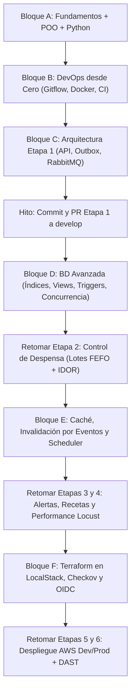

# Ruta de Aprendizaje y Práctica (Antes de Retomar Etapas del Proyecto)

Este documento modela el **plan de entrenamiento progresivo** para que domines cada fundamento (Programación, POO, Python, PostgreSQL avanzado, Caché, RabbitMQ y DevOps) **antes** de seguir avanzando con las siguientes etapas de código de la aplicación **Despensa**.

---

## Mapa de Sincronización: Práctica vs Etapas del Proyecto

---

## Guías de Estudio Disponibles en `docs/`

1. **[fundamentos_python_y_practica.md](file:///c:/Users/buda_/Documents/AI_projects/Despnsa%20project/docs/fundamentos_python_y_practica.md)** — Repaso de programación, POO, SOLID, Python 3.12, `type hints`, `async/await`, `Protocol`, Pydantic, FastAPI, SQLAlchemy, RabbitMQ y Pytest.
2. **[ejercicios_fundamentos_3_niveles.md](file:///c:/Users/buda_/Documents/AI_projects/Despnsa%20project/docs/ejercicios_fundamentos_3_niveles.md)** — Banco de **24 ejercicios progresivos en 3 etapas** (Básica, Intermedia y Avanzada) con ejemplos de apps reales aplicados a Despensa.
3. **[guia_devops_desde_cero.md](file:///c:/Users/buda_/Documents/AI_projects/Despnsa%20project/docs/guia_devops_desde_cero.md)** — Gitflow, `.gitignore`, `.env`, `Dockerfile` línea por línea, `docker-compose.yml` línea por línea, `.github/workflows/ci.yml` línea por línea y camino a Terraform/AWS.
4. **[guia_arquitectura_etapa1.md](file:///c:/Users/buda_/Documents/AI_projects/Despnsa%20project/docs/guia_arquitectura_etapa1.md)** — Cómo viajan los datos en la Etapa 1, preguntas de autoevaluación y ejercicios en Swagger/Mailpit/RabbitMQ.
5. **[guia_bd_avanzada_y_cache.md](file:///c:/Users/buda_/Documents/AI_projects/Despnsa%20project/docs/guia_bd_avanzada_y_cache.md)** — Constraints, Índices y `EXPLAIN ANALYZE`, Views y Materialized Views, Stored Procedures/Functions/Triggers, Bloqueos y Estrategias de Caché (Redis).

---

## Checklist por Bloques (Tu Ritmo de Avance)

### Bloque A — Fundamentos de Programación, POO y Python *(Hacer ahora)*
- [ ] **A1:** Repasar variables, estructuras (`list`, `dict`, `set`), funciones puras y excepciones (Módulo 0 en `fundamentos_python_y_practica.md`).
- [ ] **A2:** Completar ejercicios de **POO**, encapsulación (`@property`), `@dataclass`, composición vs herencia y SOLID (Módulo 1B).
- [ ] **A3:** Practicar fechas UTC/`ZoneInfo`, códigos HTTP e idempotencia (Módulo 1C).
- [ ] **A4:** Ejecutar los módulos de `type hints`/`mypy`, `async/await`, `Protocol` y `Pydantic`.

### Bloque B — DevOps desde Cero *(Hacer ahora)*
- [ ] **B1:** Entender cada línea de `Dockerfile` (etapas `builder`, `dev`, `prod`, usuario no-root).
- [ ] **B2:** Entender `docker-compose.yml` (redes internas, volúmenes, `healthcheck`, `migrate`).
- [ ] **B3:** Entender `.github/workflows/ci.yml` (cada job de calidad y seguridad en PRs).
- [ ] **B4:** Practicar comandos básicos de Gitflow (`status`, `diff`, `add`, `commit`, `PR`).

### Bloque C — Dominio de Etapa 1 + Primer PR *(Cierre de Etapa 1)*
- [ ] **C1:** Completar los 6 ejercicios en vivo de `guia_arquitectura_etapa1.md` (Swagger, Mailpit, apagar `worker`, RabbitMQ UI).
- [ ] **C2:** Responder las 9 preguntas de autoevaluación de la Etapa 1.
- [ ] **C3:** Hacer tu primer `commit` en `feature/etapa-1-users-outbox`, subir la rama y abrir tu **Pull Request hacia `develop`** viendo los 4 jobs de CI en verde.

### Bloque D — Base de Datos Avanzada *(Antes de Etapa 2)*
- [ ] **D1:** Practicar Constraints (`CHECK`, `UNIQUE`, `FK`) y diseño de tablas de inventario/lotes.
- [ ] **D2:** Crear índices compuestos/parciales y leer un `EXPLAIN ANALYZE` en PostgreSQL.
- [ ] **D3:** Crear una `VIEW` y un `TRIGGER` de `updated_at` en `despensa_test` (y entender cuándo usar **Stored Procedures** vs código Python).
- [ ] **D4:** Practicar bloqueos (`FOR UPDATE` / `SKIP LOCKED`) para evitar errores de concurrencia al descontar stock.
- **→ Listo para retomar Etapa 2 (`pantry`: lotes FEFO, `Idempotency-Key`, tests IDOR).**

### Bloque E — Caché, Scheduler y Performance *(Antes de Etapas 3 y 4)*
- [ ] **E1:** Entender patrones de caché (*Cache-Aside*, TTL, *Stampede*) e invalidación reactiva por eventos de RabbitMQ.
- [ ] **E2:** Practicar pruebas de carga con **Locust** y detección de consultas N+1.
- **→ Listo para retomar Etapas 3 y 4 (`notifications`, `scheduler`, `recipes` y Locust).**

### Bloque F — Infraestructura como Código y AWS *(Antes de Etapas 5 y 6)*
- [ ] **F1:** Practicar conceptos de AWS (VPC, subredes públicas/privadas, IAM mínimo privilegio, ECS Fargate, RDS, SNS/SQS).
- [ ] **F2:** Practicar `terraform init / plan / apply / destroy` contra **LocalStack** (`$0`) y escaneo con **Checkov**.
- **→ Listo para retomar Etapas 5 y 6 (AWS `dev`, OIDC, OWASP ZAP y `prod`).**
